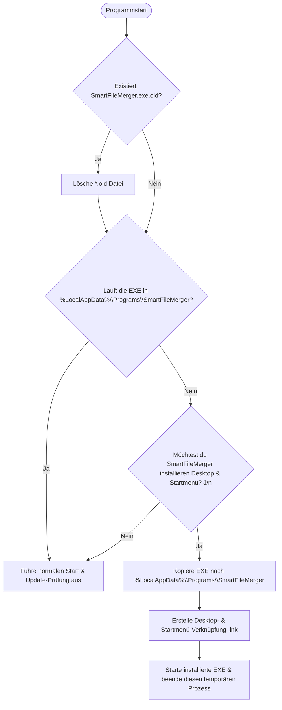
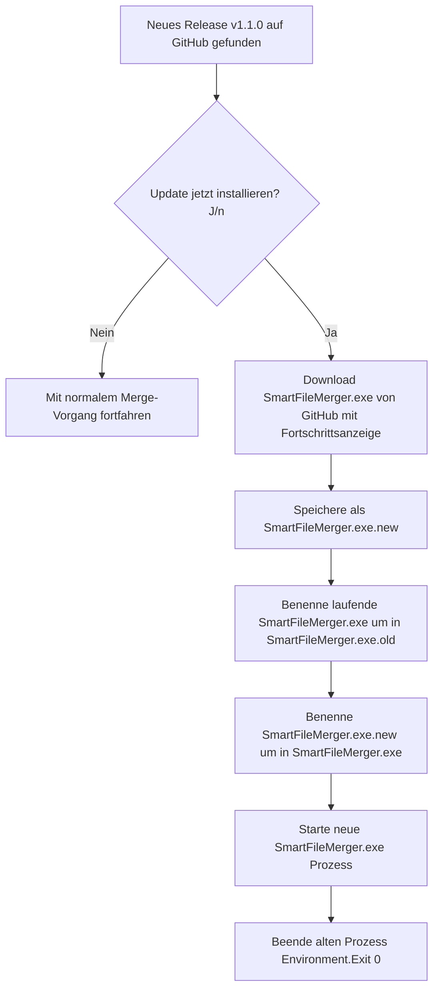

# Design-Spezifikation: SmartFileMerger Installer & Self-Updater

**Datum:** 2026-11-05  
**Status:** In Review  
**Autor:** Marc Rambow & Antigravity  
**Repository:** [github.com/mrambow/smart-file-merger](https://github.com/mrambow/smart-file-merger)  
**Target:** .NET 10.0 (C# 14), Windows x64 (Self-Contained Single-File)  

---

## 1. Übersicht & Zielsetzung

Das Ziel dieser Erweiterung ist es, `SmartFileMerger` für technisch nicht-versierte Endanwender (z. B. Marcs Frau) barrierefrei nutzbar zu machen:
1. **Keine technischen Voraussetzungen:** Weder .NET SDK noch .NET Runtime müssen auf dem Rechner installiert sein.
2. **Single-File Executable:** Eine einzige, eigenständige `SmartFileMerger.exe`, die per Doppelklick startet.
3. **1-Klick Auto-Setup:** Läuft das Programm noch im Download-Ordner, bietet es beim Start an, sich automatisch nach `%LocalAppData%\Programs\SmartFileMerger\` zu installieren und Desktop- sowie Startmenü-Verknüpfungen anzulegen.
4. **Vollautomatisches In-App-Update:** Erkennt das Tool beim Start ein neues GitHub-Release, fragt es den Nutzer direkt:  
   *„Ein neues Update (v1.1.0) ist verfügbar! Möchtest du es jetzt automatisch installieren? [J/n]“*  
   Bei Bestätigung wird das Update mit Fortschrittsbalken geladen, atomar im laufenden Betrieb getauscht und die neue Version gestartet.
5. **Automatisierte GitHub-Release-Pipeline:** GitHub Actions baut bei jedem Git-Tag (`v*`) automatisch das fertige Self-Contained Binary und hängt es an das Release an.

---

## 2. Architektur & Komponenten-Design

### 2.1 Verzeichnis- & Dateistruktur

```text
smart-file-merger/
├── .github/
│   └── workflows/
│       ├── ci.yml
│       ├── claude-pr-gate.yml
│       └── release.yml                    # NEU: Automatischer Self-Contained Release-Build bei Tags
├── src/
│   └── SmartFileMerger/
│       ├── SmartFileMerger.csproj         # ERWEITERT: PublishSingleFile, SelfContained win-x64 Profile
│       ├── Program.cs                     # ERWEITERT: Startup Cleanup (*.old), Auto-Setup & Update-Prompt
│       ├── Domain/
│       │   └── Interfaces/
│       │       ├── IAppInstallationService.cs   # NEU: Setup & Desktop/Startmenü-Shortcuts
│       │       ├── IUpdateDownloadService.cs     # NEU: Download & In-Place File-Swap
│       │       ├── IUpdateCheckService.cs
│       │       └── IUserInterface.cs             # ERWEITERT: Prompts für Setup & Update-Download
│       └── Infrastructure/
│           ├── WindowsAppInstallationService.cs  # NEU: Copy nach LocalAppData + Shell Link Erstellung
│           └── WindowsUpdateDownloadService.cs   # NEU: Asset-Download + Windows In-Use Rename Trick
└── tests/
    └── SmartFileMerger.Tests/
        └── Infrastructure/
            ├── WindowsAppInstallationServiceTests.cs
            └── WindowsUpdateDownloadServiceTests.cs
```

---

## 3. Workflows & Datenfluss

### 3.1 Erststart- & Auto-Setup-Workflow



#### Details zu `IAppInstallationService`:
- **Zielverzeichnis:** `%LocalAppData%\Programs\SmartFileMerger\SmartFileMerger.exe` (benötigt keine Administratorrechte).
- **Verknüpfungen (`.lnk`):**
  - Desktop: `Environment.GetFolderPath(SpecialFolder.Desktop)\SmartFileMerger.lnk`
  - Startmenü: `Environment.GetFolderPath(SpecialFolder.StartMenu)\Programs\SmartFileMerger.lnk`
  - Erstellung über Windows Script Host / COM (`WScript.Shell`) oder native Shell-Link-APIs.

---

### 3.2 In-App Self-Update-Workflow (Windows In-Use Rename Trick)

Windows sperrt eine laufende Datei gegen Überschreiben und Löschen, **erlaubt jedoch das Umbenennen**. Dies nutzen wir für einen absolut nahtlosen Austausch:



#### Details zu `IUpdateDownloadService`:
- Asset-Name im GitHub Release: `SmartFileMerger.exe`
- Download per `HttpClient` mit Stream-Reporting an die UI-Progressbar (`Action<double> progressCallback`).
- Fehler-Rollback: Bricht der Download ab, bleibt die aktuelle Datei vollständig intakt (`*.new` wird gelöscht, die Originaldatei wurde noch gar nicht angefasst).

---

## 4. Schnittstellen-Definitionen

```csharp
namespace SmartFileMerger.Domain.Interfaces;

public interface IAppInstallationService
{
    bool IsRunningFromInstalledLocation();
    string GetInstalledDirectoryPath();
    string GetInstalledExecutablePath();
    void InstallToUserProgramsAndCreateShortcuts();
}

public interface IUpdateDownloadService
{
    void CleanupOldExecutableIfExists();
    Task<bool> DownloadAndApplyUpdateAsync(
        string downloadUrl,
        Action<double> progressCallback,
        CancellationToken cancellationToken = default);
}
```

Erweiterungen in `IUserInterface`:
```csharp
bool PromptForInstallation();
bool PromptForUpdateInstallation(string latestVersion);
void RunWithDownloadProgress(string version, Func<Action<double>, Task> downloadWork);
```

---

## 5. GitHub Actions Release-Workflow (`.github/workflows/release.yml`)

```yaml
name: Release Build & Publish

on:
  push:
    tags:
      - 'v*'
  workflow_dispatch:

permissions:
  contents: write

jobs:
  build-and-release:
    runs-on: windows-latest
    steps:
      - name: Checkout Code
        uses: actions/checkout@v4

      - name: Setup .NET 10
        uses: actions/setup-dotnet@v4
        with:
          dotnet-version: '10.0.x'

      - name: Run Tests
        run: dotnet test --configuration Release

      - name: Publish Self-Contained Single-File (win-x64)
        run: >
          dotnet publish src/SmartFileMerger/SmartFileMerger.csproj
          -c Release
          -r win-x64
          --self-contained true
          -p:PublishSingleFile=true
          -p:IncludeNativeLibrariesForSelfExtract=true
          -p:EnableCompressionInSingleFile=true
          -o ./publish

      - name: Create GitHub Release & Upload Asset
        uses: softprops/action-gh-release@v2
        with:
          files: |
            ./publish/SmartFileMerger.exe
          generate_release_notes: true
```

---

## 6. Verifikations- & Testkonzept

1. **Unit-Tests (`SmartFileMerger.Tests`):**
   - `WindowsAppInstallationServiceTests`: Pfadvalidierung, Erkennung von `%LocalAppData%`, idempotente Shortcut-Erstellung.
   - `WindowsUpdateDownloadServiceTests`: Download-Stream-Verarbeitung mit Mock-HttpMessageHandler, Überprüfung der Dateiumbenennungslogik (`.new` -> `.old` -> `.exe`), Rollback bei Download-Fehlern.
   - `StartupCleanupTests`: Überprüfung, dass `SmartFileMerger.exe.old` beim Start gelöscht wird.
2. **End-to-End-Verifikation:**
   - Lokaler `dotnet publish`-Lauf erzeugt eine reale `SmartFileMerger.exe`.
   - Testausführung der gebauten Single-File-EXE.
